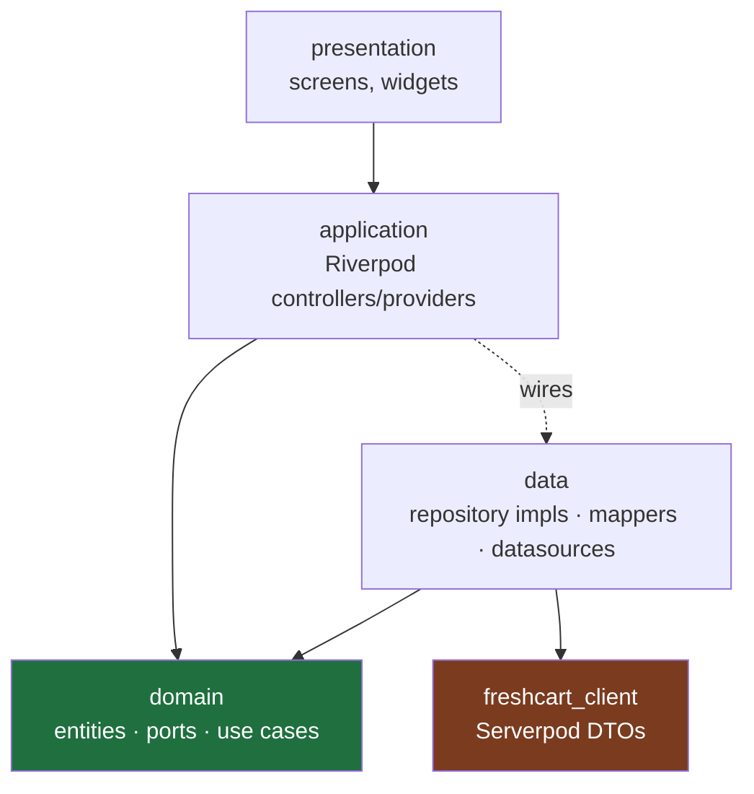

# CLAUDE.md — FreshCart

> This file is the operating manual for any AI agent (Claude Code) working in this repo.
> It is loaded on every task. Read it before touching code. The deeper specs live in
> `docs/`: read `docs/architecture.md` before writing anything in `packages/` or a
> feature's `data/` layer, and follow `docs/build-plan.md` for what to build next.

## What FreshCart is

A collaborative shopping-list app. Multiple people share a list; anyone can add, edit,
remove, check off, and annotate items in real time. Items can be tagged to a shop, the
list filters by shop, shops carry a colour, and the app theme shifts to the active shop's
colour. Built as three surfaces at once from one Dart monorepo: a Flutter app (iOS,
Android, installable web PWA), a Jaspr marketing site (the SEO surface), and a Serverpod
backend.

It is **deliberately over-engineered, for defensible reasons** — it is a portfolio piece.
Every non-obvious choice must have an interview-ready justification (see `docs/decisions.md`).
That is *not* a licence to add complexity for its own sake — see the scope rule below.

## The golden rules (non-negotiable)

1. **The dependency rule points inward.** `packages/freshcart_domain` is pure Dart. It must
   never import Flutter, Serverpod, the generated client, Firebase, or any I/O package.
   If you are about to add such an import to the domain layer, stop — you have the design
   wrong. See `docs/architecture.md`.
2. **Serverpod types never cross into the domain.** Generated client models are DTOs. They
   are mapped to pure domain entities at the `data/` boundary, and never leak upward into
   `application/` or `presentation/`. This mapping is the whole point of the layering; do
   not "save time" by skipping it.
3. **Feature-first, not layer-first.** Code is organised by feature (`lists`, `items`,
   `shops`, `auth`, `notifications`), and within a feature by layer.
4. **Plan before you build.** For any phase or non-trivial change, write the plan (files,
   layering, acceptance check) and confirm it fits these rules *before* generating code.
5. **Each phase must compile and pass its checks before the next begins.** Run the phase's
   acceptance commands (`docs/build-plan.md`). A phase is not done until they pass. Never
   stack a second phase's work on an unverified first phase.
6. **Scope discipline.** Before adding anything not in the current phase, say plainly
   whether it is a genuine learning/portfolio win or scope creep, and get a yes. "We could
   also add X" is not a reason to add X.
7. **KISS inside the rigour.** The *architecture* is strict; the *app* should feel simple.
   Prefer the simplest implementation that respects the layering. Reach for a pattern only
   when it earns its keep.

## Working with the human (Nikolaos)

He is a recent SE graduate: strong in Flutter/Dart, new to Serverpod and Jaspr, learning
clean architecture. The relationship is **mentor, not autopilot**:

- Explain the *why*. When you make an architectural call, give the one-line reason.
- Push back in the first sentence if a request heads toward an anti-pattern, then show the
  better path. Honest disagreement beats agreement.
- Default to guiding; write full code when he is genuinely stuck or when a worked example
  is the fastest way to learn. Each phase in the build plan has a **Learning toggle**:
  respect the mode set for that phase.
- Do not over-explain Flutter basics. Do explain Serverpod, Jaspr, and clean-arch nuance.

## Stack (pin exact versions in pubspec; these are the known-good floors)

| Concern            | Choice                              | Floor / note |
| ------------------ | ----------------------------------- | ------------ |
| Language           | Dart                                | 3.13+ (Serverpod 3.4 floor is 3.8) |
| App                | Flutter                             | latest stable |
| Backend            | Serverpod                           | 3.4.13 (3.5 is beta — opt-in only) |
| Marketing site     | Jaspr                               | 0.23.x — **not** a workspace member, see decisions #13 |
| Monorepo           | Pub workspaces (`workspace:`)       | Dart 3.6+ — no Melos; 5 members, `freshcart_web` resolves separately |
| State + DI         | Riverpod + `riverpod_generator`     | Riverpod 3.x / generator 4.x (needs analyzer 13+) |
| Routing            | `go_router`                         | latest |
| Entities / unions  | `freezed` 4.x (domain: **no** `json_serializable`, see decisions #12) | needs analyzer 13+ |
| i18n               | `slang`                             | locales: `nl` (default), `en`, `fr` |
| Push               | Firebase Cloud Messaging **only**   | behind a port; nothing else from Firebase |
| Lints              | root `analysis_options.yaml`        | strict — see that file |

> **Serverpod / Jaspr / Riverpod 3 / freezed 4 knowledge is thin and moves fast.** Riverpod 3
> and freezed 4 both broke APIs this file previously assumed at 2.x/earlier. Do not recall
> their APIs from memory. Verify against the official docs (`docs.serverpod.dev`, `docs.jaspr.site`) and the
> reference material in this project, and say when you are unsure instead of inventing an
> API. Generate the Serverpod base with `serverpod create` rather than hand-writing its
> scaffolding.

## Monorepo map

```
freshcart/
├── CLAUDE.md                 ← you are here
├── analysis_options.yaml     ← strict lints, inherited by every package
├── pubspec.yaml              ← workspace root (lists members)
├── docs/
│   ├── architecture.md       ← layering, import matrix, mapping pattern — READ FIRST
│   ├── build-plan.md         ← phased, verifiable build order
│   └── decisions.md          ← interview-ready justification for every choice
├── packages/
│   ├── freshcart_domain/     ← PURE Dart: entities, value objects, failures, ports, use cases
│   └── freshcart_l10n/       ← slang translations, shared by app + web
├── freshcart_server/         ← Serverpod server (endpoints, business ops, DB models)
├── freshcart_client/         ← Serverpod-generated client (do not hand-edit)
├── freshcart_flutter/        ← the Flutter app (feature-first; data layer maps client→domain)
└── freshcart_web/            ← Jaspr marketing site (SSG, the SEO surface)
                              ↑ NOT a pub workspace member — own lockfile (decisions #13)
```

## Layering (enforced)



- **domain** knows nothing below it. Pure Dart. The green box imports nothing outward.
- **data** implements the domain's `Repository` ports, talks to `freshcart_client`, and
  maps Serverpod DTOs ↔ domain entities. The brown box (Serverpod types) stops here.
- **application** depends on domain (use cases, entities) and is wired to concrete data
  implementations through Riverpod providers.
- **presentation** depends on application only.

## Conventions

- **Errors:** no throwing across layer boundaries for expected failures. Use cases and
  repositories return `Result<T>` (a `freezed` union: `Ok(value)` / `Err(Failure)`).
  Reserve exceptions for truly exceptional/programmer errors.
- **Naming:** `PascalCase` types, `camelCase` members, `snake_case` files. Entities are
  nouns (`ShoppingList`, `ShoppingItem`, `Shop`). Use cases are verbs (`AddItem`,
  `JoinList`). Repository interfaces end in `Repository`; implementations in
  `RepositoryImpl`. Mappers are `X.toDomain()` / `X.toDto()` extensions.
- **Files:** one public declaration per file where practical. Feature layout in
  `docs/architecture.md`.
- **No secrets in the repo.** Firebase config, Serverpod passwords, service keys stay in
  ignored config/`.env`. Never commit `google-services.json` / `GoogleService-Info.plist`.
- **Commits:** Conventional Commits (`feat:`, `fix:`, `refactor:`, `test:`, `docs:`,
  `chore:`), one logical change each.
- **Tests live beside the phase that adds the feature**, not bolted on at the end. Minimum:
  pure unit tests for every use case; endpoint tests for server ops; widget tests for the
  key flows (add item, join list, theme switch).

## Definition of done (every phase)

1. `dart analyze` / `flutter analyze` clean (zero warnings — lints are errors here).
2. The phase's acceptance commands in `docs/build-plan.md` pass.
3. New use cases have unit tests; they pass.
4. No golden-rule violation (re-check the import matrix in `docs/architecture.md`).
5. `docs/decisions.md` updated if a new non-obvious choice was made.

## Command cheatsheet

```bash
# workspace
dart pub get                         # resolves the whole workspace
dart analyze                         # static analysis, whole tree
dart test                            # pure Dart tests (domain, server)

# server (from freshcart_server/)
serverpod generate                   # regenerate protocol + client after model/endpoint changes
dart run bin/main.dart --apply-migrations   # run server, apply DB migrations
serverpod create-migration           # after changing DB model yaml

# app (from freshcart_flutter/)
dart run build_runner build --delete-conflicting-outputs   # riverpod/freezed/slang codegen
flutter analyze
flutter test
flutter run

# web (from freshcart_web/)
jaspr serve                          # dev
jaspr build                          # static/SSR build
```

> After changing anything Serverpod-modelled or any `@riverpod` / `freezed` / slang source,
> **regenerate before you analyze** — most "phantom" errors are stale generated code.
