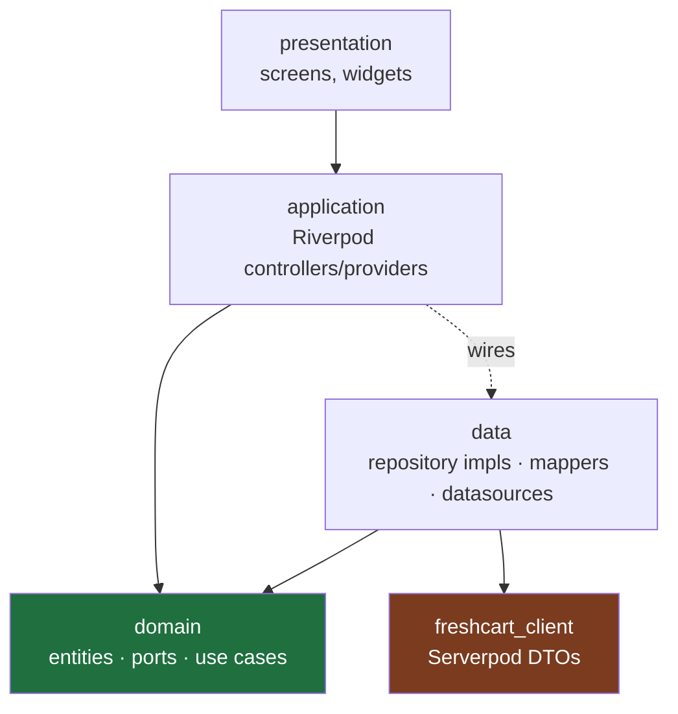

# CLAUDE.md — FreshCart

Project context and conventions for AI coding agents (Claude Code) working in this repo.
Longer design notes live in a local `docs/` folder that is not committed; when it is
absent, this file is the source of truth.

## What FreshCart is

A collaborative shopping-list app. Multiple people share a list; anyone can add, edit,
remove, check off, and annotate items in real time. Items can be tagged to a shop, the
list filters by shop, shops carry a colour, and the app theme shifts to the active shop's
colour. Built as three surfaces from one Dart monorepo: a Flutter app (iOS, Android,
installable web PWA), a Jaspr marketing site (the SEO surface), and a Serverpod backend.

The architecture is intentionally strict (clean architecture, a pure Dart domain shared
by app and server). Every non-obvious choice should have a written reason; complexity
without one does not go in.

## Architecture rules

1. **The dependency rule points inward.** `packages/freshcart_domain` is pure Dart. It
   never imports Flutter, Serverpod, the generated client, Firebase, or any I/O package.
   Needing such an import in the domain means the design is wrong.
2. **Serverpod types never cross into the domain.** Generated client models are DTOs. They
   are mapped to domain entities at the `data/` boundary and never reach `application/`
   or `presentation/`. Don't skip the mapping to save time; it is the point of the layering.
3. **Feature-first, not layer-first.** Code is organized by feature (`lists`, `items`,
   `shops`, `auth`, `settings`, `notifications`), and within a feature by layer.
4. **Keep it simple inside the structure.** The architecture is strict; the app should
   feel simple. Prefer the simplest implementation that respects the layering, and reach
   for a pattern only when it earns its keep.

## How to work in this repo

- **Plan before non-trivial changes:** files touched, which layer each lives in, and how
  it will be verified. Check it against the rules above before writing code.
- **Verify before stacking.** A change is done when it analyzes clean and its tests pass.
  Don't build the next change on top of an unverified one.
- **Stay in scope.** If something outside the current task seems worth adding, propose it
  and wait for a yes rather than adding it.

## Stack (pin exact versions in pubspec; these are the known-good floors)

| Concern           | Choice                                                    | Floor / note                                                         |
| ----------------- | --------------------------------------------------------- | -------------------------------------------------------------------- |
| Language          | Dart                                                      | 3.13+ (Serverpod 3.4 floor is 3.8)                                   |
| App               | Flutter                                                   | latest stable                                                        |
| Backend           | Serverpod                                                 | 3.4.13 (3.5 is beta — opt-in only)                                   |
| Marketing site    | Jaspr                                                     | 0.23.x — **not** a workspace member (see below)                      |
| Monorepo          | Pub workspaces (`workspace:`)                             | Dart 3.6+ — no Melos; 5 members, `freshcart_web` resolves separately |
| State + DI        | Riverpod + `riverpod_generator`                           | Riverpod 3.x / generator 4.x (needs analyzer 13+)                    |
| Routing           | `go_router`                                               | latest                                                               |
| Entities / unions | `freezed` 4.x                                             | needs analyzer 13+; domain has **no** `json_serializable`            |
| i18n              | `slang`                                                   | locales: `nl` (default), `en`, `fr`, `ru`, `tl`                      |
| Push              | Firebase Cloud Messaging **only**                         | behind a port; nothing else from Firebase                            |
| Lints             | root `analysis_options.yaml`                              | strict — see that file                                               |

- **Why `freshcart_web` is outside the workspace:** `jaspr_builder` 0.23 pins analyzer 12,
  while `freezed` 4 and `riverpod_generator` 4 need analyzer 13. A workspace has one
  resolution, so the site keeps its own lockfile. Re-merge once Jaspr moves to analyzer 13.
- **Why the domain has no JSON:** serialization is a wire concern. Serverpod already
  generates the DTOs; entities describe what things *are*, not how they travel.

> **Serverpod, Jaspr, Riverpod 3 and freezed 4 move fast**, and Riverpod 3 / freezed 4 both
> broke 2.x-era APIs. Verify APIs against the official docs (`docs.serverpod.dev`,
> `docs.jaspr.site`, pub.dev) instead of recalling them, and say when unsure.

## Monorepo map

```text
freshcart/
├── CLAUDE.md
├── analysis_options.yaml     ← strict lints, inherited by every package
├── pubspec.yaml              ← workspace root (lists members)
├── packages/
│   ├── freshcart_domain/     ← pure Dart: entities, value objects, failures, ports, use cases
│   └── freshcart_l10n/       ← slang translations, shared by app + web
├── freshcart_server/         ← Serverpod server
│   └── lib/src/<feature>/    ← endpoint (thin) + business/ (services, ListAccess
│                               guards, ListBroadcast) + models/ (.spy.yaml)
├── freshcart_client/         ← Serverpod-generated client (do not hand-edit)
├── freshcart_flutter/        ← the Flutter app (feature-first; data layer maps client→domain)
│   └── lib/
│       ├── app/              ← composition root: app, router, session, replay wiring
│       ├── core/             ← shared infrastructure; never imports features/
│       │   ├── offline/      ← drift db, cache, pending-ops queue, replay, status
│       │   ├── theme/, ui/   ← tokens + AppTheme; shared widgets (feedback, sheet…)
│       │   └── error/, l10n/, preferences/, …
│       ├── features/<f>/     ← data/ (Remote/Offline repos, mappers), application/
│       │                       (controllers), presentation/ — see Layering
│       └── demo/             ← web demo only (main_demo.dart)
└── freshcart_web/            ← Jaspr marketing site (SSG); own lockfile, not a workspace member
```

## Layering



- **domain** knows nothing below it. Pure Dart. The green box imports nothing outward.
- **data** implements the domain's `Repository` ports, talks to `freshcart_client`, and
  maps Serverpod DTOs ↔ domain entities. The brown box (Serverpod types) stops here.
- **application** depends on domain (use cases, entities) and is wired to concrete data
  implementations through Riverpod providers.
- **presentation** depends on application only.

## Conventions

- **Errors:** no throwing across layer boundaries for expected failures. Use cases and
  repositories return `Result<T>` (`Ok(value)` / `Err(Failure)`). Reserve exceptions for
  truly exceptional/programmer errors.
- **Naming:** `PascalCase` types, `camelCase` members, `snake_case` files. Entities are
  nouns (`ShoppingList`, `ShoppingItem`, `Shop`). Use cases are verbs (`AddItem`,
  `JoinList`). Repository interfaces end in `Repository`; implementations in
  `RepositoryImpl`, or, where the feature works offline, a `RemoteXRepository`
  (server calls only) wrapped by an `OfflineXRepository` decorator (queue,
  cache). Mappers are `X.toDomain()` / `X.toDto()` extensions.
- **Riverpod naming:** a Notifier class (state + methods) is `XController`; a
  screen-level Notifier that composes other providers is `XScreenController`,
  its state `XScreenState`. A Notifier backing an embedded section rather
  than a whole route is `XSectionController`, its state `XSectionState`
  (`ItemsSectionController`). A function provider (derived value or DI wiring, no
  methods) has no suffix. Notifiers get their own file (`x_controller.dart`);
  a feature's small derived providers share one `<feature>_providers.dart`; a
  repository's DI provider sits at the bottom of its `_impl.dart` (or of
  `offline_x_repository.dart`). Use cases have **no** providers — build them
  at the call site from the repository provider.
- **Use case or repository?** Business rules live on entities and value
  objects (`ShoppingItem.validateName`, `toggleChecked`). A use case applies
  those rules, then calls ports: it never calls another use case. A
  controller calls a use case when the operation has a rule to apply, and
  the repository directly when it has none (a true/false, a delete). Don't
  add a use case that only forwards to a repository.
- **One notifier per widget; a screen VM only when it earns it.** A widget
  reads and acts through exactly one application notifier (ambient core ones
  — translations, haptics, theme prefs — don't count). Next to it, it may
  read derived function providers (pure computed values with no methods,
  like `isListOwner` or `showUpgradeNudge`): folding those into the notifier
  would only add forwarding. A screen gets an `XScreenController` only when
  it combines 2+ sources or runs multi-step actions; otherwise it uses its
  one feature controller directly. Don't add a VM whose whole job is
  forwarding calls; a VM that combines sources forwards its actions too, so
  the widget keeps one front door. Dialogs/sheets/snackbars stay in the
  widget; the write behind them comes from the notifier (or as a callback).
- **Files:** one public declaration per file where practical (the grouped
  `_providers.dart` files above are the deliberate exception).
- **No secrets in the repo.** Firebase config, Serverpod passwords, service keys stay in
  ignored config/`.env`. Never commit `google-services.json` / `GoogleService-Info.plist`.
- **Commits:** Conventional Commits (`feat:`, `fix:`, `refactor:`, `test:`, `docs:`,
  `chore:`), one logical change each.
- **Tests ship with the feature**, not bolted on at the end. Minimum: unit tests for every
  use case; endpoint tests for server ops; widget tests for the key flows (add item, join
  list, theme switch).

## Definition of done

1. `dart analyze` / `flutter analyze` clean (zero warnings — lints are errors here).
2. Tests pass; new use cases have unit tests.
3. No architecture-rule violation (domain imports, DTO leakage).
4. Any new non-obvious choice has its reason written down.

## Commands

```bash
# workspace
dart pub get                         # resolves the whole workspace
dart analyze                         # static analysis, whole tree
dart test                            # pure Dart tests (domain, server)

# server (from freshcart_server/)
serverpod generate                   # regenerate protocol + client after model/endpoint changes
dart run bin/main.dart --apply-migrations   # run server, apply DB migrations
serverpod create-migration           # after changing DB model yaml

# app (from freshcart_flutter/)
dart run build_runner build          # riverpod/freezed codegen
                                     # (--delete-conflicting-outputs is gone; it's ignored)
flutter analyze
flutter test
flutter run

# translations (from packages/freshcart_l10n/)
dart run slang                       # NOT build_runner: slang_build_runner ignores
                                     # slang.yaml and silently generates Flutter-coupled
                                     # code with the wrong base locale and file name.
                                     # CI (.github/workflows/ci.yml) does the same.

# web (from freshcart_web/)
jaspr serve                          # dev
jaspr build                          # static/SSR build
```

## Shipping to phones: release or patch?

The Android app is a Shorebird release, so phones can take Dart-only fixes
without a new APK.

- **Patch** (Actions → Patch → Run workflow, with the release version such as
  `1.1.1+10`): Dart code only. Phones download it in the background and run it
  from the next restart. It refuses native, plugin, asset or Flutter-version
  changes on its own. **Deploy any server change the patch needs first.**
- **Release** (bump `version:` in `freshcart_flutter/pubspec.yaml`, commit
  `chore(release): X`, tag `vX`, push the tag): anything a patch can't carry.
  It publishes the APK, the web demo and the Shorebird release in one go.
- **Why both build with the same `SERVER_URL`:** a patch replaces all the
  Dart code, compile-time defines included, so a patch built without it would
  point phones at the wrong server.

> After changing anything Serverpod-modelled or any `@riverpod` / `freezed` / slang source,
> **regenerate before you analyze**: most "phantom" errors are stale generated code.
