<!-- markdownlint-disable MD033 MD041 -- GitHub needs inline HTML to size and centre images. -->
<div align="center">


# FreshCart

**A shared shopping list for the whole household, sorted by shop, live on every phone.**

[](https://github.com/Sporidis/freshcart/actions/workflows/ci.yml)


iOS and Android app · marketing site · backend — **one Dart monorepo**

<br>

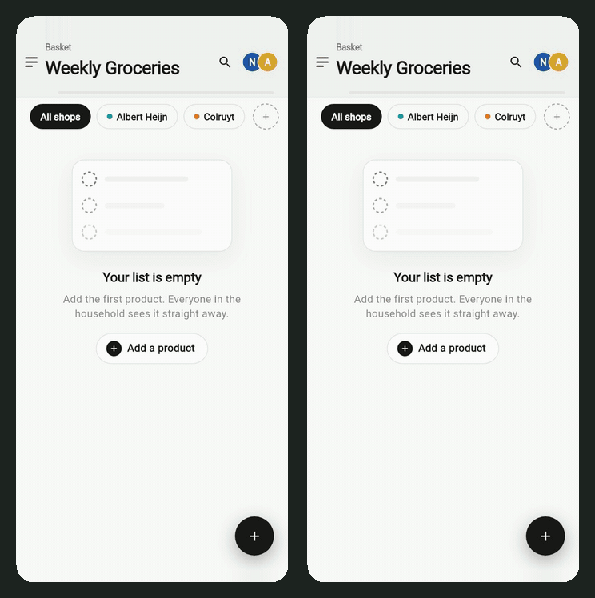

<sub>Two people, one list. Each phone switches to its own shop's colour, and every add or check-off shows up on the other phone straight away.<br>Recorded from the real app on two phone-sized screens, syncing through a local Serverpod server.</sub>

</div>

---

## What it does

- **Real-time collaboration.** Everyone on a list sees adds, edits, check-offs and removals as they happen, with who did what ("Checked off by Anna").
- **Organised by shop.** Tag items to Albert Heijn, Colruyt or any shop you add. Filter the list per shop, and the app re-themes to that shop's colour.
- **Join in seconds.** Share a 5-character code. No account needed: sign-in starts anonymous and can be linked to a real account later.
- **Works offline.** Changes are cached and queued locally, and replayed when the connection returns.
- **Feels fast.** Checking, editing and removing update the screen immediately. If the server rejects a change, it is rolled back and the app says why.
- **Push notifications** when someone adds to a shared list, batched into one per list instead of one per item.
- **Five languages:** Dutch (default), English, French, Russian and Tagalog, including correct plural rules.
- **Light and dark mode**, plus a marketing site built for search engines.

## Screenshots

<table>
  <tr>
    <td align="center">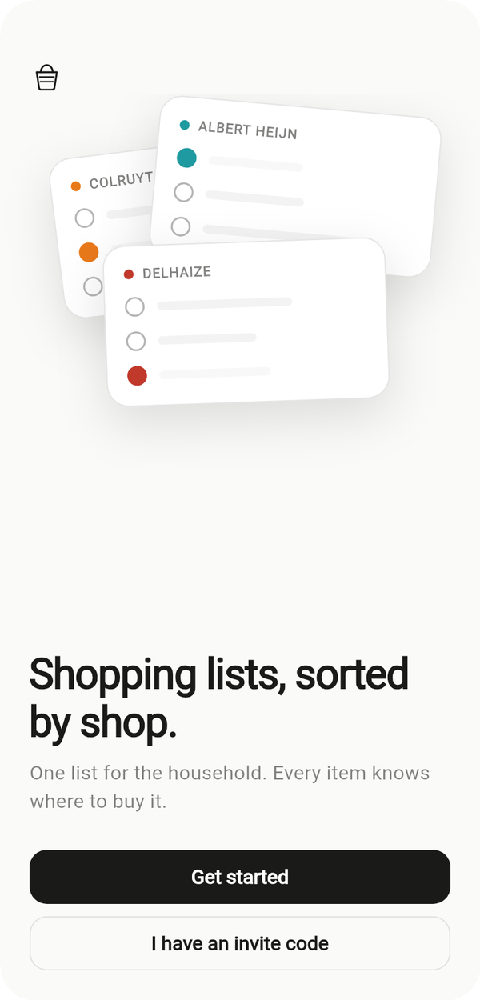<br><sub>Welcome</sub></td>
    <td align="center">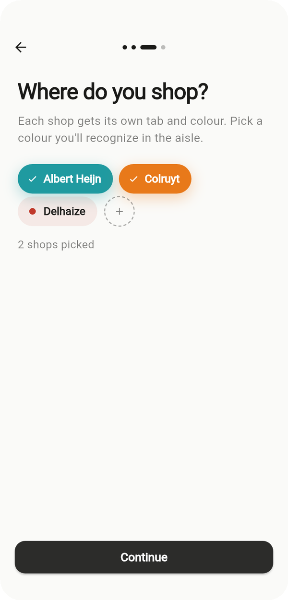<br><sub>Pick your shops</sub></td>
    <td align="center">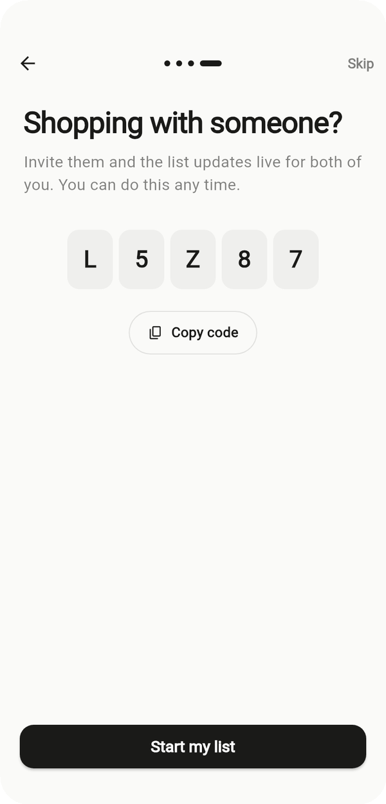<br><sub>Share a code</sub></td>
    <td align="center">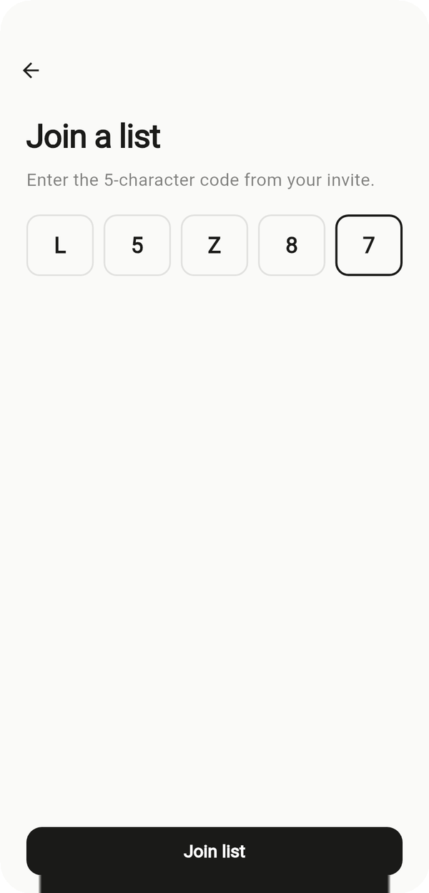<br><sub>Join with it</sub></td>
  </tr>
  <tr>
    <td align="center">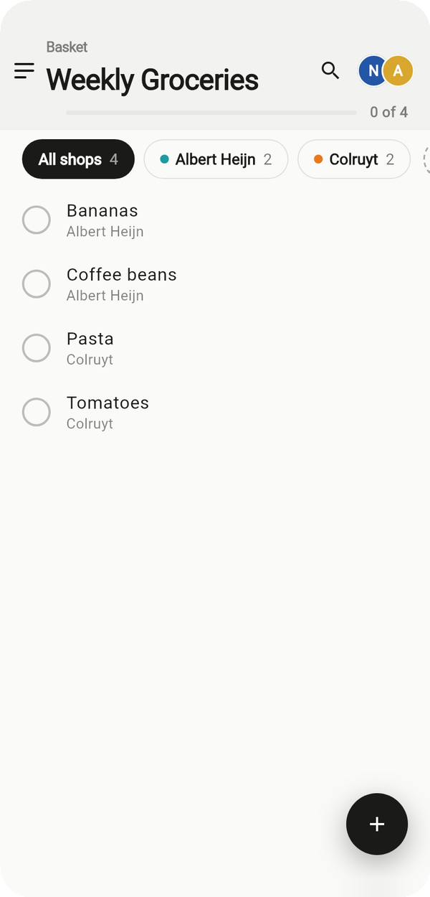<br><sub>All shops</sub></td>
    <td align="center">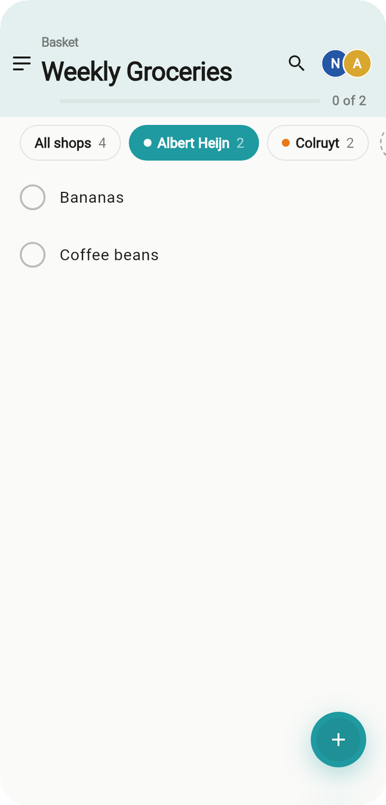<br><sub>Themed per shop</sub></td>
    <td align="center">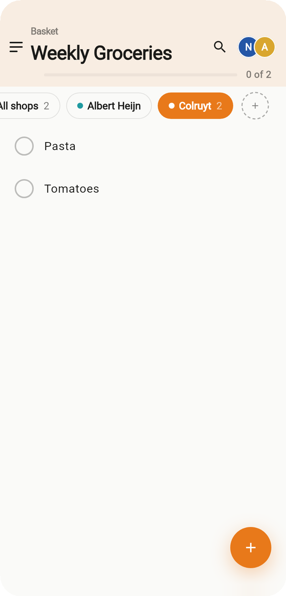<br><sub>…for every shop</sub></td>
    <td align="center">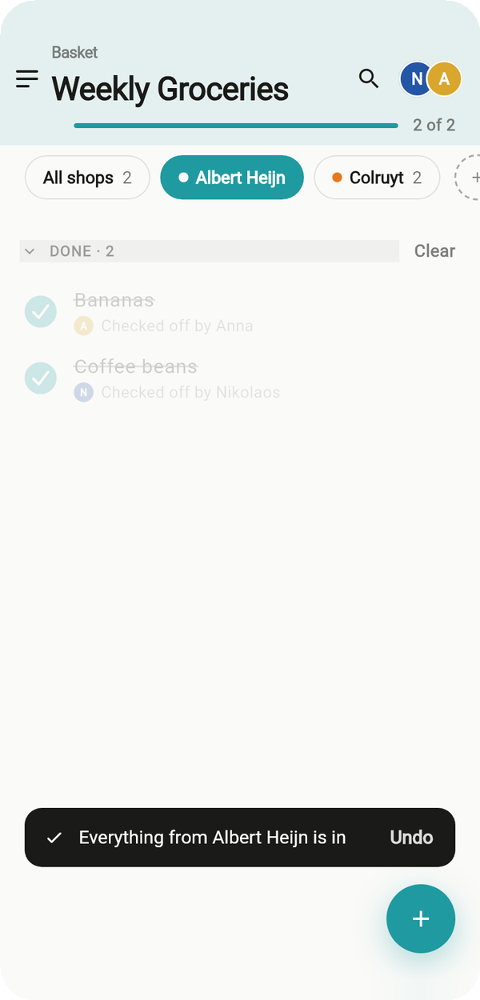<br><sub>Who checked what</sub></td>
  </tr>
  <tr>
    <td align="center">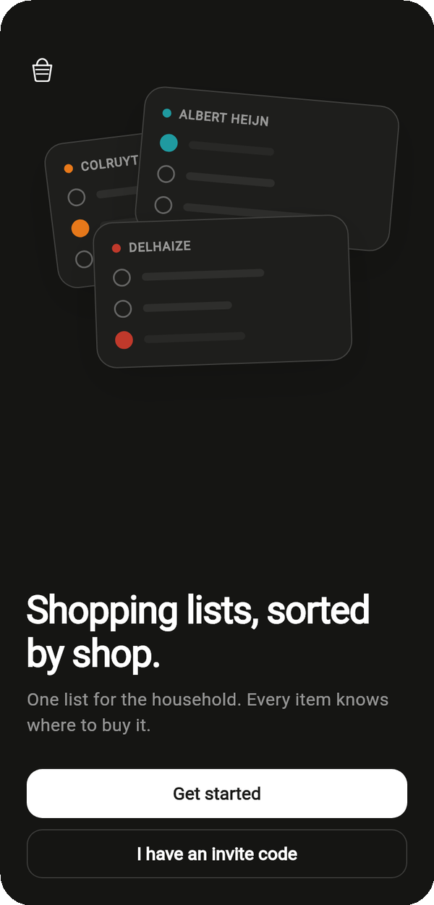<br><sub>Dark mode</sub></td>
    <td align="center">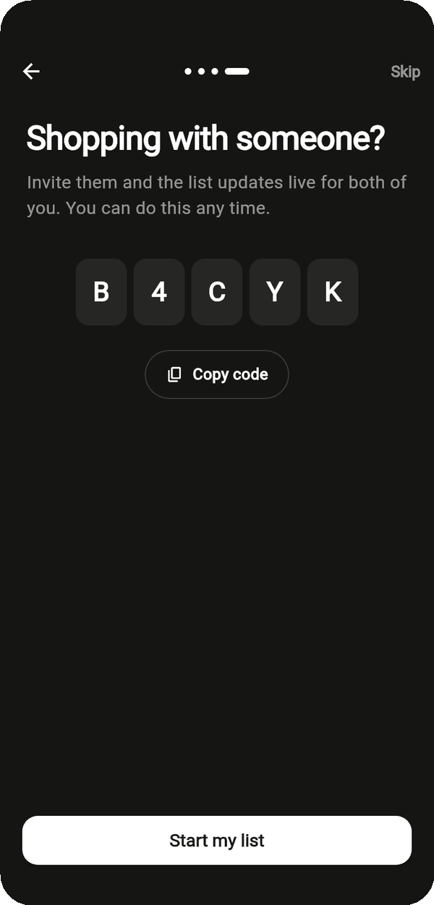<br><sub>Dark · invite</sub></td>
    <td align="center">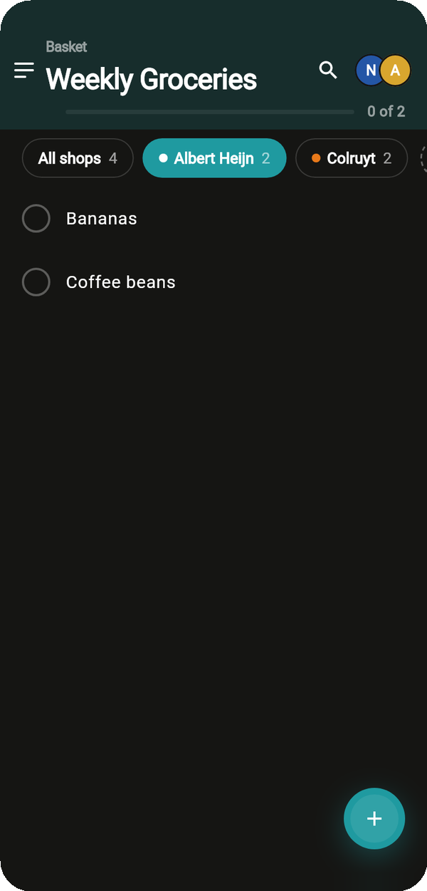<br><sub>Dark · Albert Heijn</sub></td>
    <td align="center">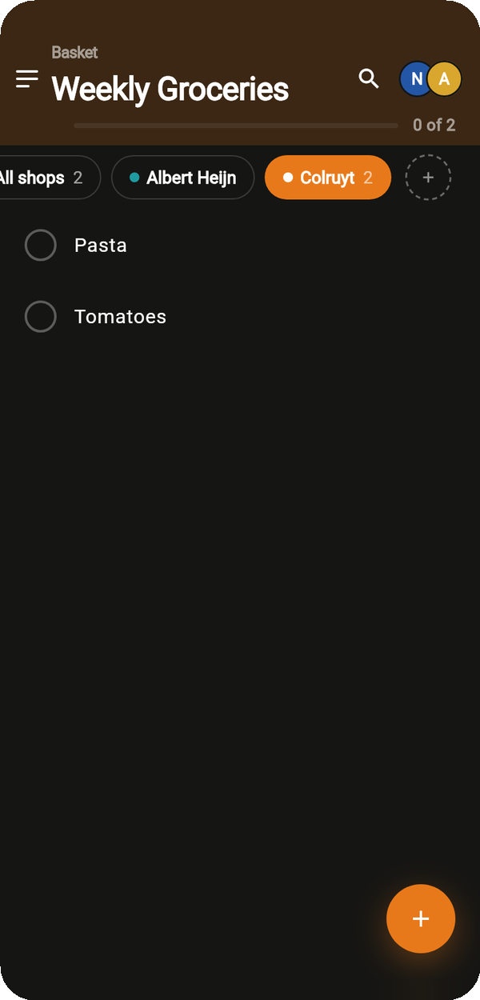<br><sub>Dark · Colruyt</sub></td>
  </tr>
</table>

<details>
<summary><b>Onboarding and joining, start to finish</b> (GIF)</summary>
<br>
<p align="center">
  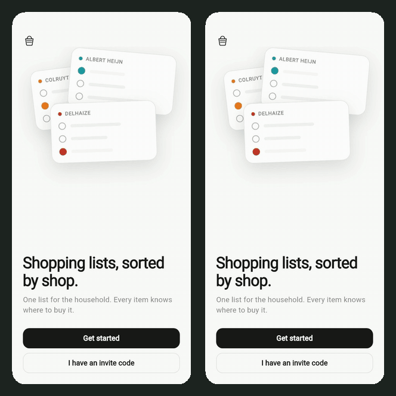
</p>
<p align="center"><sub>Left: create a name, a list and its shops, then share the code. Right: join with that code. Shown at 1.3× speed.</sub></p>
</details>

## Why it is built this way

FreshCart is my personal project, and still a work in progress. I used it to bring together things I already know, like Flutter and Riverpod, and to learn and explore things I didn't yet, like Serverpod, Jaspr and a strict clean architecture. That's why it has **more structure than a shopping list strictly needs**: the app is simple to use, but the architecture is strict and every non-obvious choice has a written reason. Highlights:

| Choice | Why |
| --- | --- |
| **A pure Dart domain package** shared by the app *and* the server | Business rules (name length, quantity, merging duplicates) are written once and enforced on both sides. You could delete Serverpod and Firebase and the domain would still compile. |
| **Serverpod DTOs are mapped at the `data/` boundary** | Generated network types never reach controllers or widgets, so the backend can change without touching the UI. |
| **`Result<T>` instead of exceptions** across layers | Expected failures (validation, conflicts, offline) are values the compiler makes you handle. |
| **Deltas over the wire, optimistic UI, `updatedAt` concurrency** | Live updates stay small. Edits feel instant and conflicts are detected, not silently overwritten. |
| **An offline decorator** (`OfflineXRepository` wraps `RemoteXRepository`) | Queueing and caching are a layer of their own. The server-talking code doesn't know offline exists. |
| **Fakes at the port boundary for the web demo** | A two-phone browser demo runs the real app with in-memory adapters for its repository ports. No screen, controller or use case was changed. |
| **CI asserts the architecture**, not just the tests | Every push checks that the domain imports nothing but Dart, and that the Serverpod client never appears above `data/`. |

### Architecture at a glance

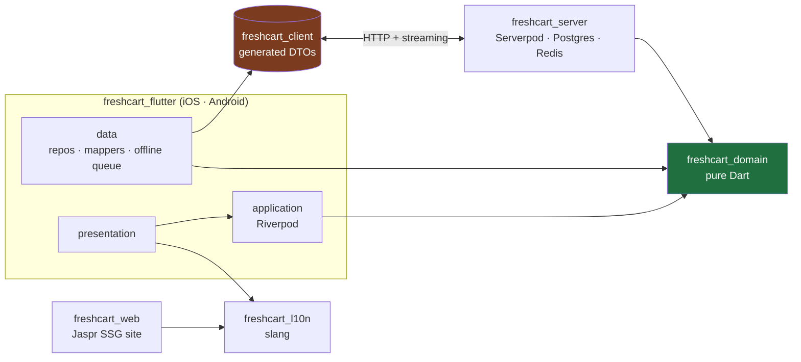

Dependencies point **inward**: the green domain imports nothing, and the brown Serverpod types stop at the app's `data/` layer.

## Tech stack

| Concern | Choice |
| --- | --- |
| App | Flutter (iOS, Android) |
| State and DI | Riverpod 3 + `riverpod_generator` |
| Routing | `go_router` |
| Entities and unions | `freezed` 4 |
| Offline cache and queue | `drift` |
| Backend | Serverpod 3.4 on Postgres + Redis |
| Marketing site | Jaspr 0.23 (static site generation) |
| i18n | `slang`, shared by the app and the site |
| Push | Firebase Cloud Messaging, and nothing else from Firebase |
| Monorepo | Pub workspaces (no Melos) |

## Repository layout

| Path | What |
| --- | --- |
| [`packages/freshcart_domain`](packages/freshcart_domain) | Pure Dart domain: entities, value objects, ports, use cases. Imports **nothing** but Dart. |
| [`packages/freshcart_l10n`](packages/freshcart_l10n) | Shared slang translations (`nl` default, `en`, `fr`, `ru`, `tl`). |
| [`freshcart_server`](freshcart_server) | Serverpod server: endpoints, business services, DB models, migrations. |
| [`freshcart_client`](freshcart_client) | Serverpod-generated client. **Never hand-edit.** |
| [`freshcart_flutter`](freshcart_flutter) | The Flutter app, organised by feature. Also holds the web demo. |
| [`freshcart_web`](freshcart_web) | Jaspr marketing site. Resolves separately (see below). |

## Getting started

**Prerequisites:** Flutter stable (Dart 3.13+), Docker, and the [Serverpod CLI](https://docs.serverpod.dev) (`dart pub global activate serverpod_cli`).

```bash
# 1. Secrets: passwords.yaml is gitignored
cp freshcart_server/config/passwords.example.yaml freshcart_server/config/passwords.yaml

# 2. Resolve dependencies. Two commands, on purpose (see below).
flutter pub get                               # the 5-member workspace
(cd freshcart_web && dart pub get)

# 3. Generate code. freezed / riverpod / slang output is not committed.
(cd packages/freshcart_domain && dart run build_runner build)
(cd packages/freshcart_l10n   && dart run slang)   # slang's CLI, NOT build_runner
(cd freshcart_flutter         && dart run build_runner build)

# 4. Start Postgres + Redis and the server
cd freshcart_server
docker compose up --build --detach
dart bin/main.dart --apply-migrations

# 5. In another terminal, run the app
cd freshcart_flutter && flutter run
```

> **Firebase:** `lib/firebase_options.dart` is gitignored. Generate your own with
> `flutterfire configure`, or copy the stub from `.github/workflows/ci.yml` if you only
> need the app to compile.
>
> **Why two `pub get`s?** `freshcart_web` is not a workspace member: `jaspr_builder` pins
> `analyzer ^12`, while `freezed` 4 and `riverpod_generator` 4 need `analyzer >=13`, and a
> pub workspace has only one resolution.

### Try it without a backend

A two-phone demo runs entirely in the browser, with no server, database or Firebase. It plays a
short scripted intro, then both phones are yours:

```bash
cd freshcart_flutter
./tool/build_demo.sh --serve        # then open http://localhost:8090/demo.html
```

Use `PORT=8099 ./tool/build_demo.sh --serve` if 8090 is taken. Pushing a `v*` tag publishes the
demo as a zip on the GitHub Release (`.github/workflows/release.yml`).

## Quality checks

```bash
dart analyze                          # whole tree, strict lints: must be clean
dart format --set-exit-if-changed .
(cd packages/freshcart_domain && dart test)
(cd packages/freshcart_l10n   && dart test)
(cd freshcart_server          && dart test)   # needs the test DB from docker compose
(cd freshcart_flutter         && flutter test)
```

CI (`.github/workflows/ci.yml`) runs on every push and pull request to `main`:

| Job | What it proves |
| --- | --- |
| **Analyze & format** | `dart analyze` and `dart format` are clean, **plus** the two golden rules checked directly: the domain imports only pure Dart, and `freshcart_client` never appears above `data/`. |
| **Domain & l10n tests** | Use-case and value-object tests; translation and plural-rule tests. |
| **Server tests** | Endpoint tests against a real Postgres, to verify migrations, foreign keys and transactions, none of which a fake would exercise. |
| **App tests** | Repository, mapper, controller and widget tests, plus a test that renders every widget preview. |
| **Marketing site builds** | The site builds, and its `<title>`, meta description, Open Graph tags, canonical URL and JSON-LD survive the build. |

Every job regenerates the `build_runner` and slang output first, because that output is deliberately not committed.

## How this was built

I built FreshCart with [Claude Code](https://claude.com/claude-code) as a pair programmer
and mentor. I made the product and architecture decisions, and reviewed and tested every
change. Claude helped explain trade-offs, wrote parts of the code, and reviewed mine. The
project rules it worked under (layering, scope, testing) are in [`CLAUDE.md`](CLAUDE.md),
next to the code.

## Contributing conventions

The golden rules, layering and commit format live in [`CLAUDE.md`](CLAUDE.md). The short version:

1. **The dependency rule points inward.** The domain never imports Flutter, Serverpod or Firebase.
2. **Serverpod types stop at `data/`.** Map DTOs to domain entities with `X.toDomain()` / `X.toDto()`.
3. **Feature-first.** `features/<feature>/{data,application,presentation}`.
4. **Conventional Commits**, one logical change each.
