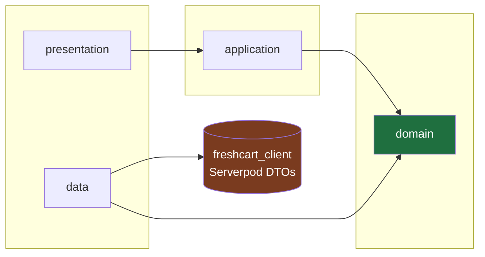
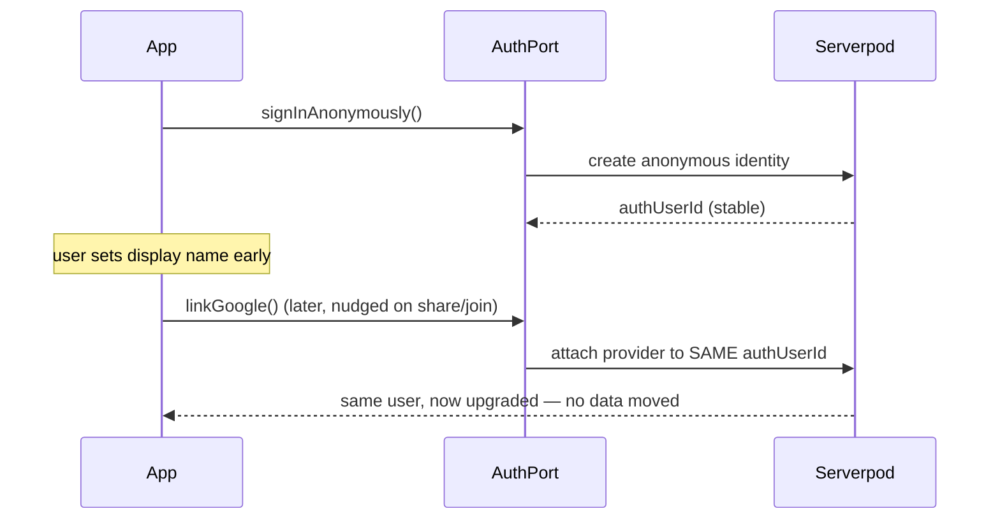
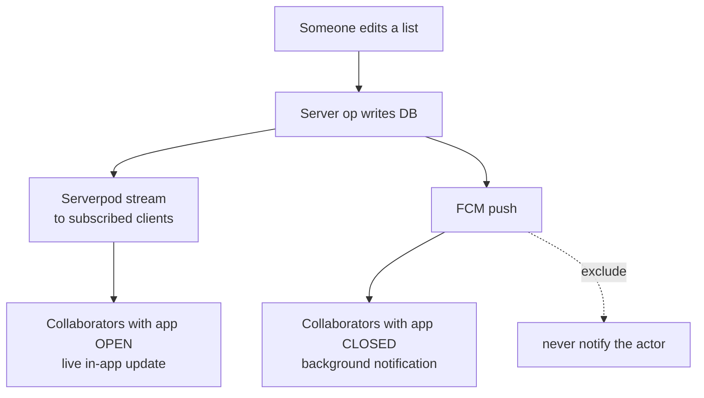

# Architecture

Read this before writing anything in `packages/freshcart_domain`, any feature's `data/`
layer, or any code that touches the Serverpod client. It defines the layering, what may
import what, and the patterns that keep the domain pure.

## The dependency rule

Dependencies point **inward**. Inner layers know nothing about outer layers. The domain is
the centre and imports nothing but pure Dart.



The single most important consequence: **you can delete Serverpod and Firebase and the
domain still compiles.** If that ever stops being true, the layering is broken.

## What may import what

A ✅ means "this row may depend on this column." Anything not ticked is a violation.

| ↓ can import →       | pure Dart | freshcart_domain | freshcart_l10n | freshcart_client | Serverpod |    Flutter    |       Firebase        |
| -------------------- | :-------: | :--------------: | :------------: | :--------------: | :-------: | :-----------: | :-------------------: |
| **domain**           |    ✅     |   ✅ (itself)    |       ❌       |        ❌        |    ❌     |      ❌       |          ❌           |
| **data**             |    ✅     |        ✅        |       ❌       |        ✅        |   ❌\*    |    ❌\*\*     | ✅ (FCM adapter only) |
| **application**      |    ✅     |        ✅        |       ❌       |        ❌        |    ❌     | ✅ (Riverpod) |          ❌           |
| **presentation**     |    ✅     |        ✅        |       ✅       |        ❌        |    ❌     |      ✅       |          ❌           |
| **server endpoints** |    ✅     |        ✅        |       ❌       |        ❌        |    ✅     |      ❌       |    ✅ (send push)     |

- \* The **app's** data layer talks to Serverpod only through the generated `freshcart_client`,
  not the `serverpod` server package.
- \*\* The data layer is plain Dart where it can be; it may depend on Flutter only for
  platform plumbing (e.g. the FCM adapter needs `firebase_messaging`). Keep that in a single
  adapter class behind a port, not spread through the layer.

> **Rule of thumb for review:** grep the domain package for `import 'package:serverpod`,
> `import 'package:flutter`, `import 'package:firebase`, `import 'package:freshcart_client`.
> Any hit is a bug.

## Where each concept lives

| Concept                                  | Lives in                                           |
| ---------------------------------------- | -------------------------------------------------- |
| Entities, value objects, `Failure` union | `packages/freshcart_domain/.../domain/`            |
| Repository **interfaces** (ports)        | `packages/freshcart_domain/.../domain/`            |
| Use cases (application-agnostic logic)   | `packages/freshcart_domain/.../domain/`            |
| Repository **implementations**           | `freshcart_flutter/.../features/<f>/data/repositories/` |
| DTO ↔ entity mappers                     | `freshcart_flutter/.../features/<f>/data/mappers/` |
| Riverpod providers/controllers           | `freshcart_flutter/.../features/<f>/application/` (flat) |
| Screens, widgets                         | `freshcart_flutter/.../features/<f>/presentation/{screens,widgets}/` |
| DB models, endpoints, server ops         | `freshcart_server/`                                |
| Generated protocol + client              | `freshcart_client/` (never hand-edit)              |

Putting entities, ports, and use cases in the shared `freshcart_domain` package (not inside
the app) is deliberate: the same pure logic is reusable by the app, the Jaspr site, and even
the server, and the compiler physically prevents Flutter/Serverpod imports from sneaking in.

## Feature folder layout (the app)

Every feature uses the same template, decided by what a file *is* rather than
what it is about -- so where a file lives is known before the folder is opened,
even when a subfolder holds a single file.

```
freshcart_flutter/lib/
├── core/                   # cross-cutting, one concern per folder (not a feature)
│   ├── di/  error/  l10n/  router/  session/  streaming/  ui/
│   └── theme/              # tokens/  preferences/  reveal/
└── features/<feature>/
    ├── application/        # flat -- the file name says what it is:
    │                       #   x_controller.dart         Notifier: feature state + actions
    │                       #   x_screen_controller.dart  screen VM (only where earned)
    │                       #   x_screen_state.dart       that VM's pure-Dart state
    │                       #   <feature>_providers.dart  small derived providers, grouped
    ├── data/
    │   ├── repositories/   # *_repository_impl.dart, its DI provider at the bottom
    │   ├── sources/        # realtime sources, adapters, local stores (grouped if many)
    │   └── mappers/        # Dto.toDomain() / Entity.toDto()
    └── presentation/
        ├── screens/        # route-level *_screen.dart
        └── widgets/        # everything else; clusters get their own folder
                            # (item_tile/, quick_add/, app_bar/, ...)
```

Only the folders a feature actually needs exist -- `onboarding/` has no
`data/`. `application/` is flat because a feature holds a handful of files
there, and the name suffix already says which kind each is (decisions #93).
Naming follows `CLAUDE.md`'s Riverpod naming rule.

Use cases have no providers: a controller builds one where it uses it,
`AddItem(ref.read(itemRepositoryProvider))(...)`. They are stateless and take
only a port, so the repository provider is the one DI seam -- and the one
tests override.

The domain half of `lists` lives in the shared package:

```
packages/freshcart_domain/lib/src/lists/
├── entities/       shopping_list.dart, list_member.dart
├── ports/          list_repository.dart          # abstract interface
└── use_cases/      join_list.dart, rename_list.dart, ...
```

## The mapping pattern (the clean-arch hill)

Serverpod generates a model, say `ShoppingList`, in `freshcart_client`. That is a **DTO** —
wire shape, nullable fields, no behavior. The domain has its own `ShoppingList` entity —
non-null invariants, value objects, methods. They are different types and the mapper is the
only bridge.

```dart
// data/mappers/shopping_list_mapper.dart
import 'package:freshcart_client/freshcart_client.dart' as dto;
import 'package:freshcart_domain/freshcart_domain.dart';

extension ShoppingListDtoX on dto.ShoppingList {
  ShoppingList toDomain() => ShoppingList(
        id: ListId(id!),                        // wrap raw id in a value object
        name: name,
        members: (members ?? const []).map((m) => m.toDomain()).toList(),
      );
}

extension ShoppingListX on ShoppingList {
  dto.ShoppingList toDto() => dto.ShoppingList(
        id: id.value,
        name: name,
        members: members.map((m) => m.toDto()).toList(),
      );
}
```

The repository implementation is where DTOs come in and entities go out — nothing above it
ever sees a `dto.` type:

```dart
// data/list_repository_impl.dart
class ListRepositoryImpl implements ListRepository {
  ListRepositoryImpl(this._client);
  final Client _client;                          // freshcart_client

  @override
  Future<Result<ShoppingList>> byId(ListId id) async {
    try {
      final dtoList = await _client.lists.byId(id.value);
      if (dtoList == null) return const Err(Failure.notFound());
      return Ok(dtoList.toDomain());
    } on ServerpodClientException catch (e) {
      return Err(Failure.network(e.message));
    }
  }
}
```

## Error handling — `Result` instead of throwing across boundaries

```dart
// packages/freshcart_domain/lib/src/core/result.dart
@freezed
sealed class Result<T> with _$Result<T> {
  const factory Result.ok(T value) = Ok<T>;
  const factory Result.err(Failure failure) = Err<T>;
}

@freezed
sealed class Failure with _$Failure {
  const factory Failure.network([String? message]) = NetworkFailure;
  const factory Failure.notFound() = NotFoundFailure;
  const factory Failure.unauthorized() = UnauthorizedFailure;
  const factory Failure.conflict() = ConflictFailure;      // e.g. optimistic-update clash
  const factory Failure.unexpected([Object? cause]) = UnexpectedFailure;
}
```

Use cases return `Result<T>`; controllers pattern-match on it and map `Failure` to a
localized message via `core/error`. Exceptions are for programmer errors only.

## Auth (locked decisions, realised here)

Serverpod-native, **anonymous-first**. One stable `authUserId` from day one; Google/email are
added later as _linked_ Serverpod providers, so upgrading an account keeps all data — no
migration. Firebase is scoped to FCM and never used for identity. Everything sits behind an
`AuthPort` in the domain so adding a provider is a swap, not a rewrite.



The collaboration risk of anonymous accounts is real: **a lost session = lost list access.**
Mitigation is product, not architecture — set the display name early, and nudge the
Google/email upgrade the moment a user creates or joins a shared list.

## Real-time + notifications — two layers



- **In-app (app open):** Serverpod streaming keeps each open list live. This is the primary
  experience; it is not push and is not affected by any platform push limitation.
- **Background (app closed):** FCM, behind a `PushPort`. Aggregate bursts ("mom added 3
  items") with a short debounce window server-side, and never notify the actor who made the
  change. Per-list mute is a user setting.

> **Documented platform limitation, on purpose:** iOS web push for PWAs is gated in the EU,
> so the free PWA-install path will not deliver background push to EU iPhones. In-app live
> updates still work. Real iOS background push needs a native build + paid Apple Developer
> account, deferred. This is a constraint we _document_, not a bug we chase.

## Dynamic theming

Each `Shop` carries a seed colour. The active shop's colour feeds
`ColorScheme.fromSeed(seedColor: shop.color)`, producing a full Material 3 scheme (light and
dark). When the active shop filter changes, the theme animates to the new scheme. "No shop"
falls back to a neutral brand seed. The seed→scheme derivation lives in `core/theme`; the
"which shop is active" state is a Riverpod provider driven by the list filter.

## Monorepo wiring

Pub workspaces (Dart 3.6+). The root `pubspec.yaml` declares members; each package keeps its
own `pubspec.yaml` but shares one lockfile and one `dart pub get`. No Melos — workspaces
cover this project's needs with far less machinery (see `docs/decisions.md`). Serverpod's
`_server` / `_client` / `_flutter` packages join the workspace alongside `packages/*`.

`freshcart_web` is the **exception**: it resolves independently with its own lockfile,
because `jaspr_builder` pins `analyzer ^12` while `freezed` 4.x and `riverpod_generator` 4.x
need `analyzer >=13`, and a workspace has a single resolution. It reaches the shared packages
through ordinary `path:` dependencies instead. Full reasoning in `docs/decisions.md` #13.
