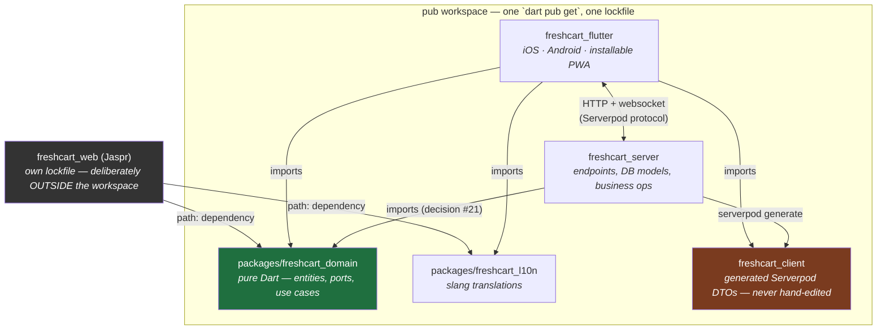

# Engineering judgment — how to read this repo, not just what it says

`docs/architecture.md` tells you the rules. `docs/decisions.md` tells you what was chosen and
why, decision by decision. This file is neither — it's the lens for reading both. It exists
because the actual skill on a portfolio piece like this isn't "did I copy the right pattern,"
it's "can I reproduce the *reasoning* on the next project, with no one telling me the answer."

If you only read one section, read [§2](#2-the-five-questions-behind-every-decision-here) and
then go re-read three entries in `decisions.md` looking for it. It's there in every one.

## 1. The whole picture

`architecture.md` diagrams the layering *inside* a feature (presentation → application →
domain ← data). It doesn't show how the five actual folders in this repo depend on each
other physically. This does:

Two things worth noticing, because both are decisions, not accidents:

- **`freshcart_domain` has no arrows leaving it.** Everything points at it; it points at
  nothing. That's decision #1, made physically true by the workspace's own dependency graph
  — the compiler enforces it, nobody has to remember to.
- **`freshcart_web` is the one box outside the workspace**, with its own lockfile, reaching in
  through an ordinary `path:` dependency instead. That's decision #13: `jaspr_builder` pins an
  older `analyzer` than `freezed`/`riverpod_generator` need, and a workspace can only resolve
  one version of a package for everyone in it. Rather than downgrade the whole app's tooling
  to fit the marketing site, the site was cut loose to resolve on its own.

## 2. The five questions behind every decision here

Open `decisions.md` at random. Almost every entry is answering the same five questions, just
in different words. This is the actual transferable skill — the questions, not the answers:

1. **What does the compiler enforce, versus what relies on someone remembering?** A rule
   that lives in a code review comment gets violated eventually. A rule that lives in an
   import graph can't be. (#1 — domain purity isn't a convention, it's a package boundary.)
2. **What's the honest alternative, and why isn't it good enough *for this project*?**
   Not "why is X good" — anything defensible sounds good in isolation. "Why X over Y, given
   *this* codebase's constraints" is the actual question an interviewer, or a future you, will
   ask. Every entry in `decisions.md` names what was rejected, not just what was picked.
3. **What's the blast radius if this turns out to be wrong?** Decisions #6 and #7 both wrap a
   risky external dependency (anonymous auth session loss, Firebase) behind a port
   specifically so the cost of being wrong is "swap an implementation," not "rewrite the app."
4. **Is this complexity paying rent today, or insuring against a future that might not
   happen?** Golden rule 7 in `CLAUDE.md` — "reach for a pattern only when it earns its keep"
   — is the KISS half of this project's stated *rigour-with-KISS* balance. Decision #5 (pub
   workspaces over Melos) picked the tool with less ceremony because nothing here needs more.
5. **What's the actual cost, said plainly?** Not "there are no downsides" — there always are.
   Decision #2's mapper boilerplate is the cost of decision #1's purity, paid on purpose and
   written down, not discovered later and resented.

## 3. Worked examples

| Decision | Alternative on the table | Why this one won | What it costs |
| --- | --- | --- | --- |
| Domain lives in its own pure-Dart package ([#1](decisions.md#1-pure-shared-domain-package-not-domain-in-app)) | Domain folders inside the app | Q1 — a Flutter import in a feature folder is a code-review miss; the same import in `freshcart_domain` is a compile error | One more package, some wiring |
| Serverpod DTOs mapped to entities at the boundary ([#2](decisions.md#2-map-serverpod-dtos-to-domain-entities-at-the-boundary)) | Use generated models as domain models directly | Q1/Q3 — skipping the mapper couples every layer to Serverpod's nullable wire shapes; swapping backends later would touch everything, not just `data/` | Mapper boilerplate on every entity |
| Riverpod + generator for state/DI ([#3](decisions.md#3-riverpod--generator-for-state-and-di)) | Bloc, or `get_it` + manual providers | Q4 — Bloc is more ceremony than this app's interaction model needs; `get_it` trades compile-time DI safety for a runtime service locator | A codegen step in the loop |
| Pub workspaces, not Melos ([#5](decisions.md#5-pub-workspaces-not-melos)) | Melos | Q4 — Melos's scripted multi-package release tooling is solving a problem this repo doesn't have yet | Comes back if the project ever needs orchestrated releases |
| `Result<T>` hand-written; `Failure`/entities stay `freezed` ([#16](decisions.md#16-result-is-hand-written-failure-and-the-entities-use-freezed)) | `@freezed` on `Result` too, for consistency | Q4/Q5 — `freezed` generates `copyWith`/`==`; `Result` never needs `copyWith`, and its `==` is four lines. What it *does* need (`fold`, `map`) can't be generated anyway | Two idioms in one package instead of one, on purpose |
| Ids as `extension type`s, not wrapper classes ([#17](decisions.md#17-ids-are-extension-types-not-wrapper-classes)) | `freezed` wrapper classes per id | Q4 — same type safety (compiler refuses `ItemId` where `ListId` belongs), zero runtime allocation, versus one generated file and one heap object per id on a screen holding hundreds | `is ListId` doesn't work at runtime — erased at compile time |

Pull up the full entry for any row — the `#N` links jump straight to it — and check whether
you can find all five questions answered inside it. If one's missing, that's usually the spot
worth pushing on.

## 4. Rigor has an edge, on purpose

It would be easy to read `architecture.md`'s strictness and conclude "more layers, more
generated code, more ports is always more correct." Decisions #16 and #17 are the two entries
that exist specifically to contradict that: `Result` skips `freezed` because generating
`copyWith` for a type that never needs it isn't rigor, it's cargo-culting the pattern used
two lines above it. The rule stated in #16 is the sharpest sentence in the whole document:

> *codegen where data-class boilerplate pays, plain Dart where the language already suffices.*

That's the KISS half of golden rule 7 actually being applied, not just asserted. The skill
isn't "always add the pattern" — it's knowing which of the five questions above the pattern
is failing, for this specific type, in this specific codebase.

## 5. Practice: a call this repo hasn't made yet

Flow 07, *Offline & sync*, is sitting at ⛔ in `build-plan.md` — "needs a connectivity port in
the domain and cached reads." Nobody has written that decision entry yet. Before you ask me
for it, draft your own, using §2's five questions:

- What would the port look like, and what does putting it in `freshcart_domain` (vs. just in
  `data/`) buy you, given decision #1?
- What's the realistic alternative — a `connectivity_plus` check sprinkled directly in
  `data/list_repository_impl.dart`? Why would that be good enough, or not?
- Optimistic edits already exist for checking/editing/removing (#29). Does offline change what
  "optimistic" means, or is it the same mechanism with a longer window?
- What's the blast radius if the caching approach picked here turns out wrong in three months?
- Say the cost out loud — cached reads mean cache-invalidation is now a real problem this app
  has. What's the honest trade-off?

Write four or five sentences, `decisions.md`-entry style. Then bring it to me — not to be
told the "right" answer, but to compare where our reasoning diverges. That gap is usually more
useful than either answer alone.
