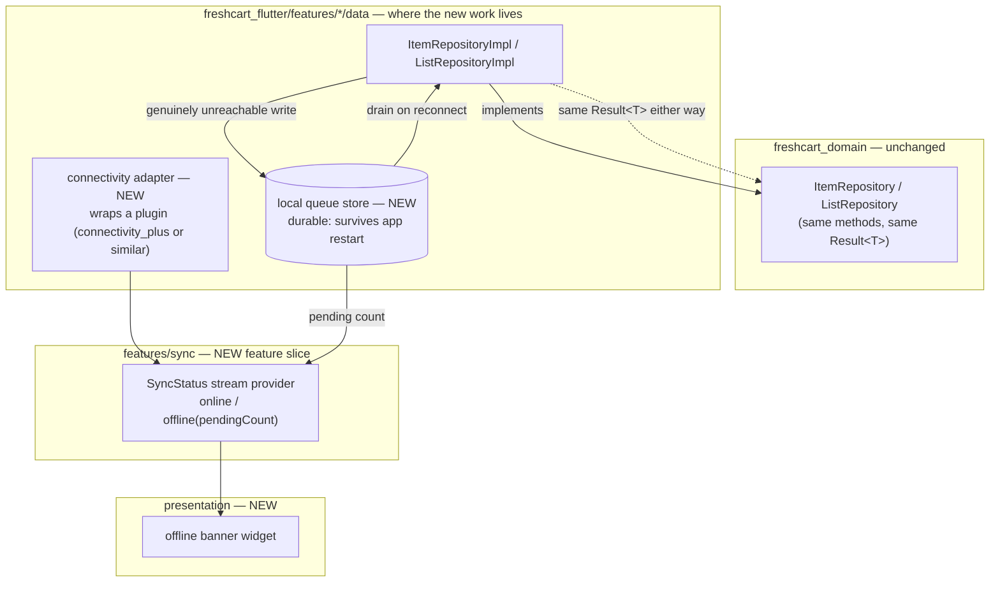
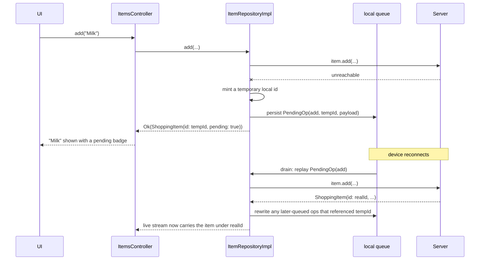

# Offline & sync — implementation plan (Flow 07)

**Status:** planning only, nothing built yet. This is scratch space for you to implement
against — it is not `decisions.md` and nothing here is locked in. Once a piece is actually
built and you're happy with the call you made, that's when it graduates into a real
`decisions.md` entry, in your own words.

This plan assumes the conclusions from the conversation that produced it:

- No new domain port for connectivity. Use cases don't change behaviour based on being
  online or offline — `data/` absorbs that entirely, same as any other resilience concern.
- The offline banner is driven by a **stream of ambient state**, not a `Failure`. A `Failure`
  is the outcome of one call; "you're offline, 3 pending" has to be true before any call is
  made.
- The optimistic-update machinery already in `ItemsController` (`freshcart_flutter/lib/features/items/application/items_controller.dart`)
  is the right thing to extend, not replace — but it currently assumes a rollback resolves in
  seconds and lives in a `Map` field that dies with the provider. Offline needs the same shape
  of idea to survive an app restart, which is a bigger structural change than it first looks.

## 1. What's already there (read this before building anything)

| Piece | File | Relevant for offline because |
| --- | --- | --- |
| `ItemRepository` / `ListRepository` ports | `packages/freshcart_domain/lib/src/items/ports/item_repository.dart`, `.../lists/ports/list_repository.dart` | These stay **unchanged**. Every method offline needs to support already exists on them. |
| Optimistic apply/rollback | `ItemsController._optimistically` | Rolls back on *any* `Failure`, no distinction by cause. Offline needs to branch: a `Failure.network` that means "genuinely unreachable" should queue, not roll back. |
| `add` is deliberately **not** optimistic | `ItemsController.add` | The server mints `id`/`createdAt`/`updatedAt`. This is the single biggest wrinkle offline introduces — see §4. |
| Error mapping, one funnel | `freshcart_flutter/lib/core/error/failure_mapper.dart` | The *only* place Serverpod exceptions become `Failure`s. This is where "was this actually a connectivity failure" gets decided. |
| Live sync | `ItemRepository.watchByList`, backed by `ItemRealtimeSource` | Already streams; the replay-on-reconnect step (§ Phase D) rides the same channel back into the UI. |
| Conflict policy today | decision #22 — `updatedAt` mismatch → `Failure.conflict()`, client re-reads | This is the policy that breaks down when the client that needs to "re-read and re-apply" wasn't there to do it. Phase D has to decide what replaces it. |

## 2. Target shape

Notice the domain box has no new arrows into it. That's the whole point of the conversation
that led here — if you find yourself adding a method to `ItemRepository` for anything
sync-related, stop and ask whether it's really a domain concern or whether it belongs in
`data/`.

**Why a new `features/sync/` slice and not `core/`:** this project already has a precedent
for "a cross-cutting capability gets its own feature folder" — `features/notifications`
holds push tokens and preferences even though nothing about push is a "shopping list"
concept. Sync status is the same shape of thing. Worth confirming this still feels right once
you're a phase or two in — it's a judgment call, not a rule.

### The one sequence worth drawing before you write code

This is the case that breaks the simple mental model — adding an item while offline, where
the server normally mints the id:

If a `toggle` or `edit` got queued against `tempId` *before* reconnect (user checked the item
they just added, still offline), that queued op has to be found and rewritten to `realId`
once the add resolves — replaying it against `tempId` would hit nothing.

## 3. Build order

Same discipline as `build-plan.md`: each phase compiles and is checkable before the next
starts. Don't stack B on top of an unverified A.

### Phase A — the signal, with no queueing behind it yet

**Goal:** an offline banner that's actually wired to real device connectivity, before any
data ever gets queued. Cheap to build, cheap to verify, and proves the "stream not Failure"
design end to end.

**Build:**
- A connectivity adapter in `features/sync/data/` wrapping whatever plugin you pick.
- A `SyncStatus` value (`online` / `offline`) and a stream provider in `features/sync/application/`.
- A banner widget in `features/sync/presentation/` (or wherever it's mounted app-wide) that
  listens to it.

**Accept:** toggling airplane mode with the app open flips the banner within a couple of
seconds, without touching any list/item code. `flutter analyze` clean.

### Phase B — a durable queue

**Goal:** somewhere for a pending write to live that isn't a `Map` field on a Riverpod
notifier, so it survives the app being killed.

**Build:** a `PendingOperation` shape (what op, what payload, what tempId if any, when it was
queued) and a store for it.

**Decision:** `drift` (real SQLite). Picked over `hive`/`isar` because this store is likely to
grow past "just a queue" — cached reads for viewing a list offline (the other half of Flow 07,
not covered by this plan) fit naturally on a real relational store, less naturally on a
key-value one. `shared_preferences` was never a contender — too primitive for structured,
queryable rows. Write the real one-paragraph "why" in `decisions.md`'s style once this is
built and the choice has actually been lived with, not before.

**Accept:** a unit test that writes a `PendingOperation`, disposes everything, re-creates the
store, and reads it back.

### Phase C — queue instead of fail, at the repository boundary

**Goal:** `ItemRepositoryImpl`/`ListRepositoryImpl` stop returning `Failure.network` for a
write when the device is genuinely offline, and persist the intent instead.

**Build:** the `_guard` helper in each repo impl (see `item_repository_impl.dart`) is the
natural interception point — it already funnels every exception through
`mapExceptionToFailure`. Decide there whether "unreachable" should queue-and-return-`Ok`
instead of surfacing `Err`.

**The `add` wrinkle from §2 lands here first** — the only method where "return `Ok`
optimistically" isn't already close to true. Every other method already targets a real
server-issued id, so queuing them is more direct.

**Decision:** don't queue on the first failure. Retry the write once or twice with backoff,
and only queue once it's still failing after that. This is more scope than the phase first
sketched — you're now building a small retry policy (attempt count, delay between them), not
just branching on a boolean. Keep it in one place — a shared helper both `ItemRepositoryImpl`
and `ListRepositoryImpl` call into, rather than duplicating backoff logic per method call
site. This is the piece of Phase C most likely to reveal that Serverpod's client throws
something more specific than a generic `ServerpodClientException` for "genuinely
unreachable" vs. "server answered with an error" — verify that against what actually gets
thrown, don't assume it from `failure_mapper.dart` alone.

**Accept:** a test asserting a single transient failure does *not* queue (it retries and can
still succeed), and a repository test that simulates sustained unreachability and asserts the
write only lands in the queue, and returns `Ok`, after the retries are exhausted.

### Phase D — replay on reconnect

**Goal:** when `SyncStatus` flips offline → online, drain the queue in call order, against
whatever the current server state actually is.

**This is where decision #22's conflict policy has to evolve.** Today: mismatched
`updatedAt` → `Failure.conflict()` → client re-reads. That assumes a person is sitting there
to re-read. A queued replay has nobody there.

**Decision:** server wins. A queued edit that conflicts on replay is dropped, not merged or
force-applied, and the user sees a "this couldn't be applied, here's what's on the list now"
summary. Write it up properly in `decisions.md` once it's built and you've seen how it feels
in practice — this is exactly the kind of call that document exists to capture.

**Accept:** an integration-style test — queue two ops offline, simulate reconnect, assert
both replay in order and the id-rewrite from Phase C's `add` case actually threads through to
a queued `toggle` on the same temp id.

### Phase E — surfacing it

**Goal:** the banner from Phase A now shows a real pending count, and a conflict from Phase D
surfaces somewhere a user will actually see it (matches the existing three-tier error
surfacing from decision #42, rather than inventing a fourth).

**Accept:** widget test — go offline, make a change, see the pending badge; come back online,
watch it clear. **Not yet built** — `item.pending`/`list.pending` exist on the domain entities
and are set correctly by the repositories, but nothing in `presentation/` reads them yet. This
is the natural next phase.

### Phase F — in-memory resilience across a live connection drop ✅ built

**Goal:** a live `watchByList`/`watch` subscription that loses its connection mid-stream doesn't
end the stream — it keeps showing the last good value and reconnects transparently once back
online, rather than surfacing an `Err` for something the app can recover from on its own.

**Built:** `core/streaming/resilient_watch.dart`. A `NetworkFailure` from the live `watch()`
stream is swallowed rather than yielded; `current` stays exactly as it was, and a loop waits for
`ConnectivityAdapter`'s online stream, re-fetches a full snapshot (deltas missed while
disconnected never arrive any other way), and resubscribes. `reconnectBackoff` guards the case
where the device reports online but the server itself is still unreachable.

This is purely in-memory — it only helps a subscription that was already alive when the
connection dropped. A cold app launch offline has nothing in memory yet, which is the gap Phase G
closes.

**Tests:** `test/core/streaming/resilient_watch_test.dart`.

### Phase G — cached reads for a cold offline start ✅ built

**Goal:** opening the app (or a list) with zero connectivity shows the last-synced state instead
of an error — the gap this plan's §4 originally deferred, closed once it turned out to be the
thing users actually noticed ("I couldn't see my list at the store").

**Built:** two new `AppDatabase` tables, `CachedLists`/`CachedItems` — one JSON blob column per
row (`data`), matching `PendingOperations`' own payload column rather than mirroring every entity
field into SQL columns, since nothing here is ever queried by a field other than the id. Wrapped
by `CachedListsStore`/`CachedItemsStore` in `features/sync/data/`, same shape as
`PendingOperationsQueue`. `ShoppingItem`'s cache codec reuses the existing
`ShoppingItemQueuePayload` (built for the offline queue's `edit` payload — already a lossless
full-entity round-trip); `ShoppingList` gets its own new `ShoppingListCachePayload`.

`resilientWatch` gained two optional hooks: `cacheWrite` (called with every value it would
otherwise yield — the seed and every later delta) and `cacheRead` (consulted only when the very
first `fetch()` fails with a `NetworkFailure` — a cold start with no signal — and falls back to
Phase F's own reconnect-and-resubscribe path once a cached value is found, rather than a second
copy of that logic). Both default to doing nothing, so no other caller of `resilientWatch` is
affected. `ItemRealtimeSource.watchByList` and `ListRealtimeSource.watch` wire them in.
`ListRepositoryImpl.myLists()` — a one-shot call, not a stream, and what `ListsScreen` actually
reads — gets the equivalent write-through/fallback by hand, since it doesn't go through
`resilientWatch` at all.

**Decision:** a cache miss (nothing ever synced) and a confirmed-empty cache (synced, genuinely
zero lists/items) are not distinguished — both read back as "nothing to show". Accepted rather
than solved with a second "has synced" marker: the case requires being offline before ever
completing a single successful sync, which for a signed-in user is vanishingly rare next to the
ongoing cost of tracking it separately (golden rule 7, KISS inside the rigour).

**Accept:** `flutter analyze` clean; `CachedListsStore`/`CachedItemsStore` round-trip tests;
`resilientWatch` cache-fallback tests; a `ListRepositoryImpl.myLists()` test asserting the cache
is consulted only on a `NetworkFailure`, never on a real error (unauthorized, etc.) that would
otherwise silently show stale data as if it were current.

**Tests:** `test/features/sync/data/cached_lists_store_test.dart`,
`test/features/sync/data/cached_items_store_test.dart`, the new cases in
`resilient_watch_test.dart`, and the new "cached reads" group in
`list_repository_impl_test.dart`.

## 4. Explicitly not in scope here (say so before anyone assumes otherwise)

- Background sync while the app is fully closed — needs platform background-task APIs, a
  separate decision with its own cost.
- Any cross-device merge UI, or CRDT-style automatic merging. Phase D's "name the v1 policy
  and accept its honest limitation" is deliberately the KISS answer here (golden rule 7)
  until there's a concrete reason it isn't enough.
- `freshcart_web` offline support (service worker caching) — different mechanism entirely,
  not assumed by anything above.

## 5. When you get stuck

Bring the specific decision, not the whole feature — same as the offline conversation that
produced this plan. "Here's my `PendingOperation` shape, here's why, does this hold up" gets
a much sharper answer than "how do I do offline sync."
