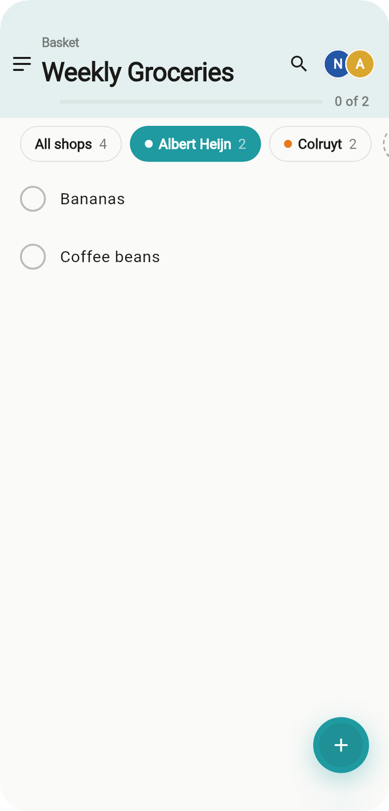
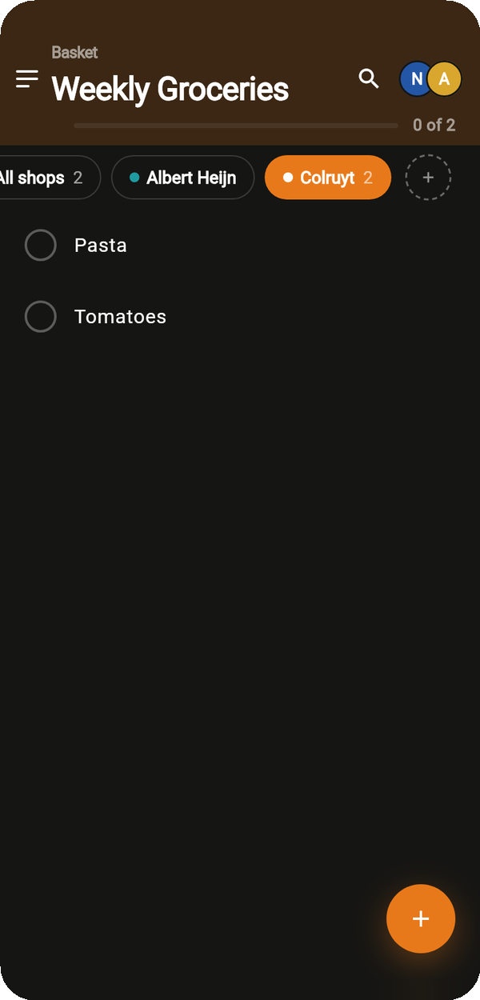

<!-- markdownlint-disable MD033 -- GitHub needs inline HTML to size images. -->
# freshcart_flutter

The FreshCart app for iOS and Android. It also holds the
backend-free [web demo](#web-demo). For the big picture, see the [root README](../README.md).

<p align="center">
  
  &nbsp;
  
</p>

## Structure

```text
lib/
├── main.dart          ← production entry point
├── main_demo.dart     ← web demo entry point (two phones, in-memory backend)
├── app/               ← composition root: app, router, session, offline replay wiring
├── core/              ← shared infrastructure; never imports features/
│   ├── offline/       ← drift database, cache, pending-ops queue, replay, status
│   ├── theme/, ui/    ← design tokens, AppTheme, shared widgets
│   └── error/, l10n/, preferences/, haptics/, …
├── features/
│   ├── auth/  items/  lists/  shops/  notifications/
│   └── onboarding/  settings/
│       └── each split into data/ · application/ · presentation/
└── demo/              ← web demo only; production code never imports it
```

| Layer | Holds | May import |
| --- | --- | --- |
| `data/` | `RemoteXRepository` (server calls), `OfflineXRepository` (queue and cache decorator), DTO ↔ domain mappers | domain, `freshcart_client` |
| `application/` | Riverpod controllers (`XController`, `XScreenController`) and derived providers | domain |
| `presentation/` | screens and widgets; one notifier per widget | application, domain, l10n |

`freshcart_client` types never leave `data/`; CI fails the build if they do.

## Running

```bash
# Once, and after changing any @riverpod / freezed source
dart run build_runner build      # or: dart run build_runner watch

# Against a local server (see ../freshcart_server)
flutter run
```

`lib/firebase_options.dart` is gitignored. Run `flutterfire configure` to generate it,
or copy the analysis stub from `.github/workflows/ci.yml` if you don't need push.

## Web demo

Two phones from **one Flutter engine** (multi-view), sharing one in-memory backend. A
scripted intro plays onboarding on phone A and joining on phone B, then both phones are
yours to use.

```bash
./tool/build_demo.sh --serve      # http://localhost:8090/demo.html (PORT=… to change)
./tool/build_demo.sh              # build and copy into the portfolio site
```

The demo swaps only the domain's repository ports (lists, items, shops, auth and
notifications) for in-memory fakes. Every screen, controller and use case above them is
production code.

## Tests

```bash
flutter test
```

These cover repositories, mappers, controllers and widgets (add item, join list, theme
switch), plus a test that renders every widget preview.
